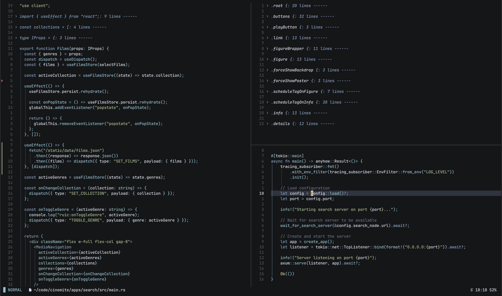

# Neovim IDE configuration

My configuration for [Neovim](https://neovim.io/), mostly for frontend development (TypeScript, CSS, python, rust).

- **Editor** - enhanced vim motions, extended text objects, folding
- **Code** - formatter, comments, code completion, AI powered suggestions
- **HTTP** - REST client for `.http` files
- **AI Assistant** - suggestions, chat, agentic
- **LSP** - Language Server Protocol client, symbols navigation, diagnostics
- **Syntax** - highlighting, syntax aware motions, text objects
- **Git integration** - status, diff, conflicts, commit message editor, buffer integration
- **Search** - fuzzy find anything, files, git changed, last buffers
- **UI** - files and directory explorer, notifications, command palette

<sub>Works on Neovim v0.12+</sub>

## Setup

### Prerequisites

- [Neovim](https://neovim.io/) v0.12+
- [Git](https://git-scm.com/)
- A [Nerd Font](https://www.nerdfonts.com/) in your terminal ([JetBrainsMono Nerd Font](https://www.nerdfonts.com/font-downloads) recommended)

### Installation

```bash
git clone https://github.com/ruicsh/nvim-config.git ~/.config/nvim
nvim
```

On first launch, [lazy.nvim](https://lazy.folke.io) will bootstrap itself and install all plugins automatically.

## Screenshots



## Theme

- **NordStone** - Custom theme based on [Nord Theme](https://www.nordtheme.com/).
- [JetBrainsMono Nerd Font](https://www.nerdfonts.com/font-downloads)

## Plugins

<sub>65 plugins</sub>

### Code

- [autopairs](https://github.com/windwp/nvim-autopairs) - Auto-pairs
- [autotag](https://github.com/windwp/nvim-ts-autotag) - Auto close/rename tags
- [blink.cmp](https://github.com/saghen/blink.cmp) - Autocomplete
- [conform](https://github.com/stevearc/conform.nvim) - Formatter
- [match-up](https://github.com/andymass/vim-matchup) - Matching pairs/words
- [mini.hipatterns](https://github.com/nvim-mini/mini.hipatterns) - Highlight patterns in text
- [tailwincss-dial](https://github.com/ruicsh/tailwindcss-dial.nvim) - Toggle TailwindCSS classes
- [tailwind-hover](https://github.com/ruicsh/tailwind-hover.nvim) - Tailwind CSS hover
- [timber](https://github.com/Goose97/timber.nvim) - Insert log statements
- [treewalker](https://github.com/aaronik/treewalker.nvim) - AST aware actions

### AI

- [copilot.lua](https://github.com/zbirenbaum/copilot.lua) - Suggestions (copilot)
- [neocodeium](https://github.com/monkoose/neocodeium) - Suggestions (windsurf)
- [sidekick.lua](https://github.com/folke/sidekick.nvim) - Agentic

### Editor

- [dial](https://github.com/monaqa/dial.nvim) - Enhanced increment/decrement
- [mini.ai](https://github.com/nvim-mini/mini.ai) - Around/inside textobjects
- [mini.align](https://github.com/nvim-mini/mini.align) - Align text interactively
- [mini.bracketed](https://github.com/nvim-mini/mini.bracketed) - Navigation with square brackets
- [mini.move](https://github.com/nvim-mini/mini.move) - Move lines/selection
- [mini.surround](https://github.com/nvim-mini/mini.surround) - Surround action
- [multicursor](https://github.com/jake-stewart/multicursor.nvim) - Multiple cursors
- [readline](https://github.com/assistcontrol/readline.nvim) - Insert/Command mode motions
- [sort](https://github.com/sQVe/sort.nvim) - Sort action
- [spider](https://github.com/chrisgrieser/nvim-spider) - Move by subwords
- [substitute](https://github.com/gbprod/substitute.nvim) - Substitute action
- [text-case](https://github.com/ruicsh/text-case.nvim) - Convert text cases
- [visual-whitespace](https://github.com/mcauley-penney/visual-whitespace.nvim) - Render whitespace
- [yanky](https://github.com/gbprod/yanky.nvim) - Yank and Put actions

### Windows

- [auto-session](https://github.com/rmagatti/auto-session) - Session management
- [hbac](https://github.com/axkirillov/hbac.nvim) - Buffer auto-closer
- [mini.clue](https://github.com/nvim-mini/mini.clue) - Keybindings helper
- [mini.notify](https://github.com/nvim-mini/mini.notify) - Notifications
- [scope](https://github.com/tiagovla/scope.nvim) - Tab scoping
- [smart-splits](https://github.com/mrjones2014/smart-splits.nvim) - Windows resize
- [termite](https://github.com/ruicsh/termite.nvim) - Terminal windows manager
- [window-picker](https://github.com/s1n7ax/nvim-window-picker) - Window picker
- [winshift](https://github.com/ruicsh/winshift.nvim) - Rearrange windows

### Git

- [codediff](https://github.com/esmuellert/codediff.nvim) - diff
- [fugitive](https://github.com/tpope/vim-fugitive) - status, commit, push
- [snacks.gitbrowse](https://github.com/folke/snacks.nvim/blob/main/docs/gitbrowse.md) - Open remote
- [gitsigns](https://github.com/lewis6991/gitsigns.nvim) - hunks, blame
- [review](https://github.com/georgeguimaraes/review.nvim) - diff comments for agents

### Navigation

- [fff](https://github.com/dmtrKovalenko/fff.nvim) - Search index (Snacks picker backend)
- [flash](https://github.com/folke/flash.nvim) - Jump with labels
- [grapple](https://github.com/cbochs/grapple.nvim) - File bookmarks
- [gx](https://github.com/chrishrb/gx.nvim) - Open links/files
- [hlslens](https://github.com/kevinhwang91/nvim-hlslens) - Browse search results
- [oil](https://github.com/stevearc/oil.nvim) - Files explorer
- [other](https://github.com/rgroli/other.nvim) - Open alternative files
- [snacks.picker](https://github.com/folke/snacks.nvim/blob/main/docs/picker.md) - Pickers
- [yazi](https://github.com/mikavilpas/yazi.nvim) - Explorer

### LSP/Syntax/Tools

- [mason-lspconfig](https://github.com/mason-org/mason-lspconfig.nvim) - Bridge between mason and lspconfig
- [mason-tool-installer](https://github.com/WhoIsSethDaniel/mason-tool-installer.nvim) - Tools installer
- [mason](https://github.com/mason-org/mason.nvim) - LSP package manager
- [nvim-lspconfig](https://github.com/neovim/nvim-lspconfig) - LSP config
- [nvim-treesitter-context](https://github.com/nvim-treesitter/nvim-treesitter-context) - Code context
- [nvim-treesitter-textobjects](https://github.com/nvim-treesitter/nvim-treesitter-textobjects) - AST aware text objects
- [nvim-treesitter](https://github.com/nvim-treesitter/nvim-treesitter) - Treesitter syntax parsers
- [rest](https://github.com/rest-nvim/rest.nvim) - HTTP client
- [vim-test](https://github.com/vim-test/vim-test) - Test runner
- [wakatime](https://github.com/wakatime/vim-wakatime) - Time tracking

## Config

### Config

Complex configuration options.

|                                                                                                        |                                  |
| ------------------------------------------------------------------------------------------------------ | -------------------------------- |
| [foldtext](https://github.com/ruicsh/nvim-config/blob/main/plugin/config/foldtext.lua)                 | Text displayed for a closed fold |
| [formatoptions](https://github.com/ruicsh/nvim-config/blob/main/plugin/config/formatoptions.lua)       | Format options                   |
| [standard-plugins](https://github.com/ruicsh/nvim-config/blob/main/plugin/config/standard-plugins.lua) | Disable unused standard plugins  |
| [statusline](https://github.com/ruicsh/nvim-config/blob/main/plugin/config/statusline.lua)             | Content of the statusline        |
| [winbar](https://github.com/ruicsh/nvim-config/blob/main/plugin/config/winbar.lua)                     | Content of the winbar            |
| [wrap](https://github.com/ruicsh/nvim-config/blob/main/plugin/config/wrap.lua)                         | Toggle soft-wrap                 |

### Filetypes

Custom configuration, keymaps, and features dependent on the file's type.

|                                                                                               |                             |
| --------------------------------------------------------------------------------------------- | --------------------------- |
| [dockerfile](https://github.com/ruicsh/nvim-config/blob/main/plugin/filetypes/dockerfile.lua) | Dockerfile                  |
| [terminal](https://github.com/ruicsh/nvim-config/blob/main/plugin/filetypes/terminal.lua)     | Terminal buffers            |
| [typescript](https://github.com/ruicsh/nvim-config/blob/main/plugin/filetypes/typescript.lua) | TypeScript LSP code actions |

### Autocmds

New features built around autocmds (events).

|                                                                                                                                  |                                                     |
| -------------------------------------------------------------------------------------------------------------------------------- | --------------------------------------------------- |
| [auto-close-buffer-if-deleted](https://github.com/ruicsh/nvim-config/blob/main/plugin/autocmds/auto-close-buffer-if-deleted.lua) | Auto close buffer when deleted from disk            |
| [auto-resize-splits](https://github.com/ruicsh/nvim-config/blob/main/plugin/autocmds/auto-resize-splits.lua)                     | Auto resize splits when window is resized           |
| [cmdline](https://github.com/ruicsh/nvim-config/blob/main/plugin/autocmds/cmdline.lua)                                           | Clean up after use, hide hit-enter messages on blur |
| [default-filetype](https://github.com/ruicsh/nvim-config/blob/main/plugin/autocmds/default-filetype.lua)                         | Markdown for new/undetected buffers                 |
| [help](https://github.com/ruicsh/nvim-config/blob/main/plugin/autocmds/help.lua)                                                 | Open Help in side panel                             |
| [show-cursorline-only-active](https://github.com/ruicsh/nvim-config/blob/main/plugin/autocmds/show-cursorline-only-active.lua)   | Show cursorline only on active window.              |

### Custom

Random features added.

|                                                                                                                              |                                        |
| ---------------------------------------------------------------------------------------------------------------------------- | -------------------------------------- |
| [duplicate-comment](https://github.com/ruicsh/nvim-config/blob/main/plugin/custom/duplicate-comment.lua)                     | Duplicate and comment                  |
| [lsp-disable-semantic-tokens](https://github.com/ruicsh/nvim-config/blob/main/plugin/custom/lsp-disable-semantic-tokens.lua) | Disable semantic tokens (LSP)          |
| [lsp-keymaps](https://github.com/ruicsh/nvim-config/blob/main/plugin/custom/lsp-keymaps.lua)                                 | Keymaps (LSP)                          |
| [lsp-highlight-references](https://github.com/ruicsh/nvim-config/blob/main/plugin/custom/lsp-highlight-references.lua)       | Highlight references (LSP)             |
| [lsp-jump-to-references](https://github.com/ruicsh/nvim-config/blob/main/plugin/custom/lsp-jump-to-references.lua)           | Jump to references (LSP)               |
| [lsp-python-set-venv](https://github.com/ruicsh/nvim-config/blob/main/plugin/custom/lsp-python-set-venv.lua)                 | Set venv for python files (LSP)        |
| [vim-messages](https://github.com/ruicsh/nvim-config/blob/main/plugin/custom/vim-messages.lua)                               | Display :messages on a separate window |

## Keymaps

### Files explorer

- `-` open directory explorer (Oil)
- `_` open current working directory (Oil)
- `<tab>` preview file
- `<bs>` go to parent directory
- `<c-w>s` open in horizontal split
- `<c-w>t` open in new tab
- `<c-w>v` open in vertical split
- `<leader>-` open Yazi at current file
- `<leader>_` open Yazi at current working directory
- `<leader>.` last picker
- `<leader><space>` files & buffers

### Buffers

- `<bs>` switch to last
- `q` close
- `<leader>,` list

### Bookmarks

- `\{a,s,d,f,g}` jump to
- `\\{a,s,d,f,g}` save to
- `<leader>\` list

### Alternate buffer

- `==` switch to
- `=<space>` switch to source
- `=b` switch to test
- `=m` switch to template
- `=s` switch to style
- `=y` switch to story

### Navigation

- `{` jump up 6 lines
- `}` jump down 6 lines
- `w`/`b` next/previous word
- `e`/`ge` next/previous word end
- `''` jump to position before last jump
- `'.` jump to position where last change was made
- `s` jump with labels
- `'{a-z}'` jump to marked position
- `mm` jump to matching pair
- `[m`/`]m` jump to previous/next matching word
- `gm` jump to previous match
- `zm` jump inside next block
- `[[` jump to earlier section (`]]` later)

### Windows

- `|` switch
- `q` close
- `<c-q>` quit
- `<c-w>t` move file to new tab
- `<c-w>m` move window
- `<c-w>x` swap windows
- `<c-w>z` toggle zoom
- `<s-tab>` toggle terminal
- `<leader>w` toggle soft-wrap

### Search

- `<leader>/` search in workspace
- `<leader>?` search in directory
- `<leader>g/` search current word in workspace
- `g/` search current word / selection
- `*`/`#` search word under cursor forward/backward
- `g*`/`g#` search partial word forward/backward
- `[/` search word under cursor
- `gr/` replace current word / selection
- `gw/` web search current word / selection
- `<c-w>/` search first occurence in new window
- `n`/`N` next/previous result

### Editing

- `[<space>` add blank line above cursor (`]<space>` below)
- `[p` paste to new line above (`]p` below)
- `gCC` duplicate `[count]` lines, comment out the first instance
- `gC` duplicate a selection, comment out the first instance (visual mode)
- `U` redo
- `V` select until end of line
- `vv` enter visual line mode
- `<c-s>` save
- `<a-h>` move line/selection left
- `<a-j>` move line/selection down
- `<a-k>` move line/selection up
- `<a-l>` move line/selection right
- `<tab>` toggle fold

### Insert/Command mode

- `<c-b>` jump character backward
- `<c-f>` jump character forward
- `<a-b>` jump word backward
- `<a-f>` jump word forward
- `<c-a>` jump to line start
- `<c-e>` jump to line end
- `<c-h>` delete character backward
- `<c-d>` delete character forward
- `<a-bs>` delete word backward
- `<a-d>` delete word forward
- `<c-w>` delete WORD backward
- `<c-k>` delete line forward
- `<c-u>` delete line backward
- `<c-v>` paste from clipboard (insert mode)
- `<c-z>` undo (insert mode)
- `<c-n>` jump to next match (command mode)
- `<c-p>` jump to previous match (command mode)

### Text objects

- `a` function argument
- `b` brackets ({}, (), [])
- `c` comment
- `%` entire file
- `f` function
- `h` git hunk
- `m` matching pair
- `q` quotes (", ', `)
- `s` single word in different cases
- `t` HTML tags

### Change text cases

- `<leader>~-` to kebab-case
- `<leader>~_` to snake_case
- `<leader>~C` to CONSTANT_CASE
- `<leader>~U` to UPPER CASE
- `<leader>~c` to camelCase
- `<leader>~p` to PascalCase
- `<leader>~u` to lower case

Also available as `<leader>g~{char}` (LSP rename) and `g~o{char}` (operator).

### Yank current filepath

- `y%` path (relative)
- `yL` path (relative) + line number

### Operators

- `ys{motion}{char}` add surrounding character
- `ds{char}` delete surrounding character
- `cs{target}{replacement}` replace surrounding character
- `S{char}` add surrounding character (visual mode)
- `<leader>x{motion}` exchange with another motion (`<leader>xx` line, `<leader>xc` cancel)
- `<leader>r{motion}` replace with register (`<leader>rr` line, `<leader>R` end of line)
- `<leader>s{motion}` sort (`<leader>ss` line)

### MultiCursor

- `<s-down>` add cursor below (`<s-up>` for above)
- `<leader><s-down>` skip cursor below (`<leader><s-up>` for above)
- `<c-s-down>` add cursor to next match (`<c-s-up>` for previous)
- `<leader><c-s-down>` skip cursor next match (`<leader><c-s-up>` for previous)
- `<leader>mm` toggle cursor
- `<leader>x` delete cursor
- `<esc>` clear cursors

### Completion

- `<c-n>` show/next entry
- `<c-p>` previous entry
- `<tab>` show/next entry
- `<s-tab>` previous entry
- `<cr>` confirm
- `<c-e>` hide
- `<c-f>` scroll docs forward
- `<c-b>` scroll docs backward

### AI suggestions

- `<c-]>` accept
- `<c-d>` dismiss
- `<a-w>` accept word
- `<a-e>` accept line
- `<a-n>` show next
- `<a-p>` show previous

### AI agent

- `<c-bslash>` show/focus (visual mode: send selection)
- `<c-w><c-bslash>` toggle
- `<c-b>` buffer picker (agent terminal)
- `<c-f>` file picker (agent terminal)

### Logging

- `glv` insert variable log below
- `glV` insert variable log above
- `glp` insert plain log below
- `glP` insert plain log above
- `glb` insert batch log below
- `gla` add to batch log
- `glk` insert breakpoint below
- `glK` insert breakpoint above
- `glt` insert timestamp below
- `glT` insert timestamp above
- `<leader>glt` insert timestamp above/below

### Syntax (AST)

- `<c-h>` jump to parent node
- `<c-j>` jump to next sibling node
- `<c-k>` jump to previous sibling node
- `<c-l>` jump to child node
- `<c-s-h>` swap with left node (`<c-H>` on Windows)
- `<c-s-j>` swap with down node (`<c-J>` on Windows)
- `<c-s-k>` swap with up node (`<c-K>` on Windows)
- `<c-s-l>` swap with right node (`<c-L>` on Windows)
- `]a` jump to next parameter start (`[a` previous)
- `]f` jump to next function start (`[f` previous)
- `]s` jump to next className (`[s` previous)

### LSP

- `K` display hover information for symbol
- `gO` list symbols in document
- `gra` code actions
- `grt` jump to type definition
- `gri` jump to implementation
- `grn` rename symbol
- `grr` list references
- `grI` list incoming calls
- `grO` list outgoing calls
- `grx` run code lens
- `<cr>` jump to definition
- `<c-w>]` jump to definition (vsplit)
- `<leader>dd` open diagnostics (file)
- `<leader>dD` open diagnostics (workspace)
- `[r` jump to previous symbol reference (`]r` next)
- `[e` jump to previous error (`]e` next)
- `[E` jump to first error (`]E` last)

### TypeScript (LSP)

- `<leader>im` add missing imports
- `<leader>io` organize imports
- `<leader>ir` remove unused
- `<leader>is` sort imports
- `<leader>iu` remove unused imports

### Git

- `[c` previous change (`]c` next)
- `<leader>h$` blame line
- `<leader>h%` current file history (diff vs HEAD)
- `<leader>h~` diff `HEAD~{count}..HEAD`
- `<leader>h<c-bslash>` AI review branch vs chosen base (defaults to default branch)
- `<leader>hB` branches
- `<leader>hD` diff explorer
- `<leader>hH` status (picker)
- `<leader>hL` search log
- `<leader>hM` review branch vs chosen base (defaults to default branch)
- `<leader>hd` diff (Gdiff)
- `<leader>hh` status
- `<leader>hl` show range history (visual mode)
- `<leader>hl%` log for file
- `<leader>hl$` blame line
- `<leader>hm` diff file vs default branch
- `<leader>hr` discard hunk
- `<leader>hR` discard buffer
- `<leader>hs` stage hunk
- `<leader>hS` stage buffer
- `<leader>hx` open file in browser
- `<leader>hX` open commit in browser

### Git merge conflicts

- `[x` previous conflict (`]x` next)
- `cb` choose both
- `co` choose current
- `ct` choose incoming
- `cx` discard

### Test runner

- `<leader>ba` run all
- `<leader>bb` run last
- `<leader>b%` run file
- `<leader>bn` run nearest

### Tabs

- `<leader><tab><tab>` new tab
- `<leader><tab>q` close tab
- `[<tab>` previous tab
- `]<tab>` next tab
- `<leader><tab>{1-9}` go to tab

### HTTP requests (REST)

- `<leader>ar` run request under cursor
- `<leader>aR` re-run last request
- `<leader>aa` pick and run request
- `<leader>ao` open result pane
- `<leader>ae` select environment
- `<leader>aE` show environment
- `<leader>ac` edit cookies
- `<leader>al` open logs

### Scratchpad

- `<leader>e` toggle scratchpad
- `<leader>E` select scratchpad

### Zen mode

- `<leader>z` toggle zen mode
- `<c-w>z` toggle zoom

### Application

- `<leader>na` autocmds
- `<leader>nh` help
- `<leader>nH` highlights
- `<leader>nk` keymaps
- `<leader>nn` vim-messages

<div style="margin-top:80px"></div>

---

<sup>&copy; 2024 Rui Costa, MIT License</sup>
